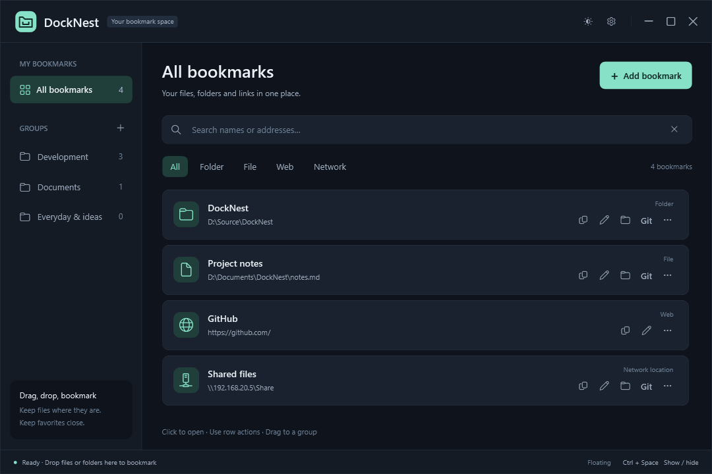
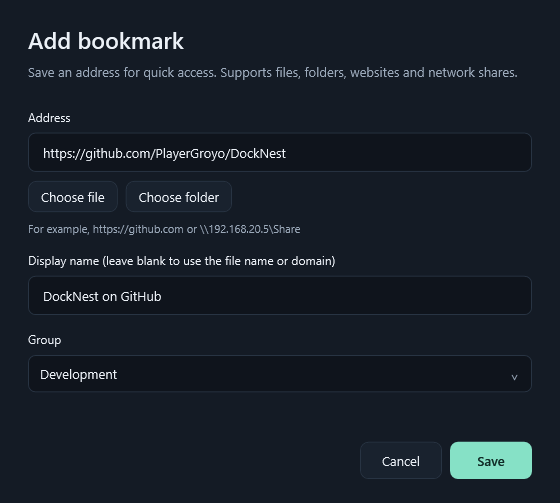
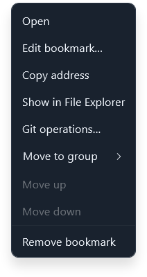
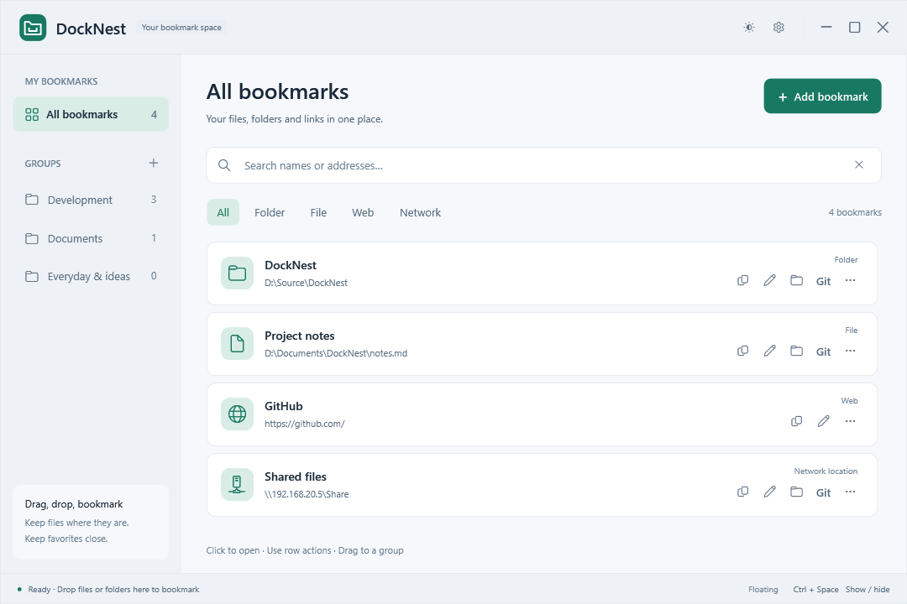
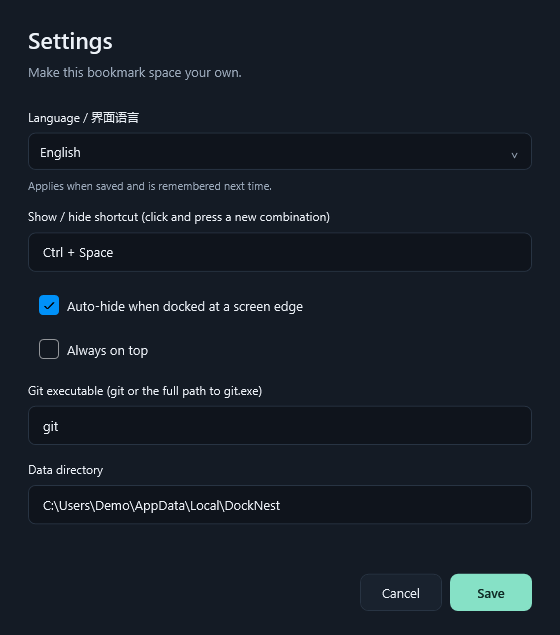
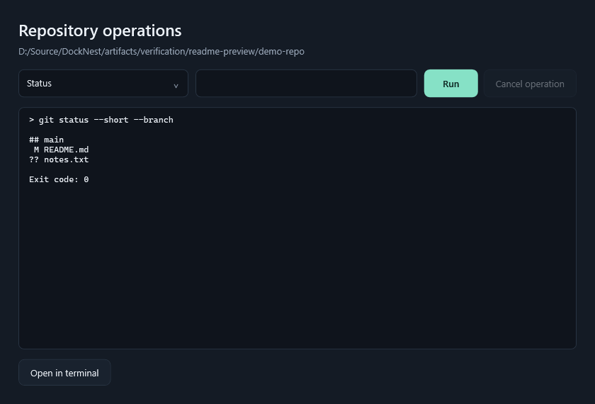

# DockNest

[简体中文](README.md) | English

A Windows desktop tool for organizing bookmarks into groups. Keep frequently used files, folders, websites and network shares in one window while leaving the original files where they are.

## Beta downloads and releases

Beta builds appear on [GitHub Releases](https://github.com/PlayerGroyo/DockNest/releases), marked **Pre-release**. Extract the entire ZIP, then run `DockNest.exe`:

| Download | Requirements |
| --- | --- |
| `DockNest-version-win-x64-self-contained.zip` | Includes .NET 8 Desktop Runtime; extract and run |
| `DockNest-version-win-x64-framework-dependent.zip` | Smaller download; requires .NET 8 Desktop Runtime x64 |
| `SHA256SUMS.txt` | SHA-256 checksums for both ZIPs |

Both packages include the Chinese and English documentation, screenshots and licenses. Git must be installed separately. Exit the previous version before updating; your bookmarks remain in `%LOCALAPPDATA%\DockNest`.

Maintainers can publish through the [Beta release workflow](https://github.com/PlayerGroyo/DockNest/actions/workflows/beta-release.yml):

1. Confirm the version in `DockNest.csproj`, for example `0.1.7`, and push the source to GitHub.
2. Open **Actions → Beta release → Run workflow**, choose a branch and enter `v0.1.7-beta.1`. Leave `publish` unchecked to build only. Download the verification packages from **Artifacts → beta-packages** on that run; no tag or Release is created.
3. Once verified, run it again with `publish` checked. After the checks pass, the workflow creates the tag and GitHub pre-release, with both ZIPs and the checksum file.

Alternatively, push a Beta tag to trigger publication directly:

```powershell
git tag v0.1.7-beta.1
git push origin v0.1.7-beta.1
```

Tags must follow `vMAJOR.MINOR.PATCH-beta.N`, with a positive Beta number and a base version matching the project. Use `beta.2`, `beta.3` and so on for subsequent builds. Published releases are never overwritten or marked as the stable Latest release. Failed uploads leave a draft; rerun the failed release job to retry. The workflow uses GitHub's automatic `GITHUB_TOKEN`, so no personal access token is needed. Verification packages, check results and UI previews are retained for 14 days.

## Usage

The screenshots use demo bookmarks and example data directories. Your first launch starts with an empty collection.

### Main window and search

Choose a group on the left, or select **All bookmarks**. Search matches names and addresses within the selected group; **All bookmarks** searches across every group. Use the filters below the search box to show folders, files, websites or network locations.



### Create groups and add bookmarks

1. Click **＋** beside **GROUPS** to create a group.
2. Click **Add bookmark**, then enter an address or choose a local file or folder.
3. Optionally enter a display name, choose a group and click **Save**. Leave the name blank to use the file name or domain.



You can also drag multiple files or folders from File Explorer into the list or directly onto a group. Plain-text URLs can be dropped too. Duplicate addresses are skipped within the same group; the same address can be bookmarked in different groups.

### Open and manage bookmarks

**Click a bookmark once to open it.** The buttons on the right are **Copy address, Edit, Locate, Git and …**, from left to right. Hover over a button to see its tooltip. Website bookmarks provide Copy, Edit and the **…** menu. Buttons perform only their own action; use Tab to focus one, then Enter or Space to activate it.

| Action | Purpose |
| --- | --- |
| Copy address | Copy the file path, folder path or URL to the clipboard |
| Edit | Change the name, address or group |
| Locate | Show the file or folder in File Explorer |
| Git | Open operations for the containing repository; see [Git](#git) |
| … / right-click | Open the full menu, including moving between groups, reordering and removing bookmarks |



Removing a bookmark deletes only its saved reference. Deleting a group removes that group and its bookmark records. The original files and folders stay in place.

### Show, hide, tray and edge docking

- **Ctrl + Space** toggles the main window. If another app or input method already uses this shortcut, DockNest reports the conflict; choose another combination in Settings.
- The tray icon appears when the app starts. Single-click or double-click it to show the main window, or right-click for **Show main window** and **Exit**. An active Settings, bookmark or Git dialog is brought forward first. Windows may put the icon in the taskbar's hidden icons area.
- Drag the title bar close to any edge of the work area, within about 12 device-independent pixels (DIP), to enable auto-hide. Moving the pointer away hides the window after a delay and leaves a green strip 6 DIP wide. Hover over the strip to reveal the window in front of other windows without taking keyboard focus. Move away to hide it again, or drag it away from the edge to undock. Undocking restores your previous always-on-top setting. Auto-hide pauses while dialogs or menus are open.
- Minimizing keeps the app in the taskbar. The close button exits the app. Launching DockNest again brings the existing window forward.

### Themes, language and settings

Click the theme button in the upper-right corner to switch between dark and light themes.



Click the gear button to open Settings. You can change the interface language, show / hide shortcut, edge auto-hide, always-on-top preference and Git executable, and view the data directory.

**To switch to English: Settings (设置) → 界面语言 / Language → English → Save (保存).** Saving immediately updates the main window, tray menu and subsequently opened dialogs. No restart is needed, and the choice is remembered next time. Canceling leaves the language unchanged. New installations and profiles from older versions default to Simplified Chinese. You can switch back by choosing **简体中文**.

Group names, bookmark names and addresses are preserved as entered. Windows controls the language of native file pickers, native message-box buttons and system error messages. Git command output is shown as returned by Git.



### Keyboard shortcuts

| Shortcut | Action |
| --- | --- |
| Ctrl + Space | Show / hide the window; configurable in Settings |
| Ctrl + F | Focus search |
| Ctrl + N | Add a bookmark |
| Ctrl + Shift + N | Create a group |
| Enter / F2 / Delete | Open / edit / remove the selected bookmark in the list |

## Git

Click **Git** beside a file or folder bookmark to open operations for its repository. Select an operation and click **Run**; the result appears below. The example shows **Status** in an isolated demo repository.



DockNest uses your installed `git.exe`; you can specify its full path in Settings. It uses `rev-parse --show-toplevel` to recognize regular repositories and linked worktrees. File bookmarks are resolved through their containing directory. Git access to network paths runs in a cancelable child process.

Supported operations include status, unstaged / staged diff, the latest 30 commits, fetch, pull with `--ff-only`, `git add --all`, committing staged changes and push. You can also open PowerShell in the repository directory. Operations apply to the **containing repository**: **Stage all repository changes** stages every change in that repository.

Operations that modify a repository or contact a remote require confirmation. Arguments are passed through `ArgumentList`, without constructing shell commands. The output includes the exit code, standard output and standard error. Commands can be canceled and time out after two minutes. Each output stream is limited to one million displayed characters to bound memory use.

Authentication uses your local Git configuration. Interactive credential prompts are disabled; if authentication fails, complete it in a terminal and retry. Canceling Git may leave partial changes, so check the repository status afterward. This version does not provide reset, force-push or automatic conflict resolution.

## Data

Data is stored in `%LOCALAPPDATA%\DockNest\state.json`, including groups, bookmarks, theme, language, shortcut and window position. Writes use a temporary file and atomic replacement, keeping the previous version as `state.json.bak`.

If the JSON is damaged, DockNest tries to restore the backup and preserves the damaged file with a `.corrupt-timestamp` suffix. If recovery fails, it keeps the files and reports the error. Data from a newer, unsupported version is rejected to prevent overwriting it. A single instance of the app owns the profile.

**Back up the entire data directory. To update the app, exit it and replace the published application files; your data remains in its separate directory.** DockNest contains no ads, telemetry or online update service.

## Development and local publishing

DockNest is a **.NET 8 WPF** project. Building requires the .NET 8 SDK or a compatible newer SDK; running the framework-dependent build requires the .NET 8 Desktop Runtime on Windows.

```powershell
dotnet build DockNest.csproj
dotnet run --project DockNest.csproj
dotnet publish DockNest.csproj -c Release -r win-x64 --self-contained false -p:DebugType=None -p:DebugSymbols=false -o artifacts/publish
```

Run `artifacts/publish/DockNest.exe` and keep the accompanying DLLs, configuration files and other published files together. Git is supplied by your local installation and is not bundled. Both READMEs and their screenshots are included in the published output.

`Models` contains data structures; `ViewModels` handles groups and filtering; `Services` handles storage, targets, Git, themes, language and window behavior; `Interop` wraps Win32; `Views` contains task dialogs; `Themes` contains styles; `Localization` contains embedded Chinese and English text resources; and `Assets` contains the app icon. Window code handles events and dialogs, while services can be checked independently.

## Verification

Run all checks in an interactive Windows desktop session:

```powershell
dotnet run --project Tests/DockNest.Checks.csproj -- artifacts/verification
```

GitHub Actions uses CI mode for data, targets, isolated Git repositories, localization resources and offscreen Chinese / English rendering. It skips system-tray, global-hotkey, screen-edge and focus interaction checks:

```powershell
dotnet run --project Tests/DockNest.Checks.csproj -c Release -- --ci artifacts/verification/ci
```

CI results are written to `ci-result.json` in the chosen output directory. To build the same Beta packages locally:

```powershell
pwsh -File .github/scripts/Build-BetaPackage.ps1 -Tag v0.1.7-beta.1
```

Packages are placed in `artifacts/beta`; temporary build files remain in `artifacts/verification/beta-packages`. Move existing ZIPs out of the output directory before repeating a local build; the script refuses to overwrite them.

Check edge docking, including real timers and actual edge-strip dimensions:

```powershell
dotnet run --project Tests/DockNest.Checks.csproj -- --docking artifacts/verification
```

Check tray registration, restoring hidden / minimized / docked windows, saving on exit and icon cleanup:

```powershell
dotnet run --project Tests/DockNest.Checks.csproj -- --tray artifacts/verification
```

Check language switching, saving / canceling Settings, compatibility with older profiles, tray updates and restoring the saved language:

```powershell
dotnet run --project Tests/DockNest.Checks.csproj -- --localization artifacts/verification
```

Verification output is kept in `artifacts/verification`. `result.json` contains the full result; `docking-result.json`, `tray-result.json` and `localization-result.json` contain focused results. PNG files render real WPF controls. Each run creates isolated data, Git repositories and local bare remotes under `fixtures/`. Tests do not use your actual bookmark directory or push to remote Git hosting services.

Coverage includes target recognition, offline UNC paths, duplicates, search, preservation of original files, storage and recovery, Git worktrees / diff / local fetch-pull-push / cancellation, shortcut conflicts, native docking, the system tray, language switching and both themes. Docking checks use real windows, timers and window ordering with controlled pointer coordinates. Tray checks query actual Windows icon registration and send click callbacks to the tray message window. The test host loads app resources without running the production single-instance or user-profile startup flow. Manual mouse interaction, multiple monitors with mixed DPI, real SMB authentication and remote Git credentials still need verification in the target environment.

## Dependencies and assets

- [WPF UI 4.3.0](https://github.com/lepoco/wpfui): themes and controls, MIT; includes WPF-UI.Abstractions of the same version.
- [CommunityToolkit.Mvvm 8.4.2](https://github.com/CommunityToolkit/dotnet): observable-property generation, MIT.
- The tray uses Windows Forms `NotifyIcon`, included in the .NET Desktop Runtime, and reuses the app icon.
- Interface text uses the system Segoe UI / Microsoft YaHei UI fonts. Symbols use Segoe Fluent Icons / Segoe MDL2 Assets. No additional fonts are downloaded or installed. See [THIRD-PARTY-NOTICES.txt](THIRD-PARTY-NOTICES.txt) for WPF UI's bundled fonts, icons and their terms.
- `Assets/DockNest.svg` and `.ico` are folder icons created for this project. The ICO includes 16, 32, 48, 128 and 256 pixel sizes.

The project is licensed under [MIT](LICENSE). Third-party copyright and license notices are retained with published files.
