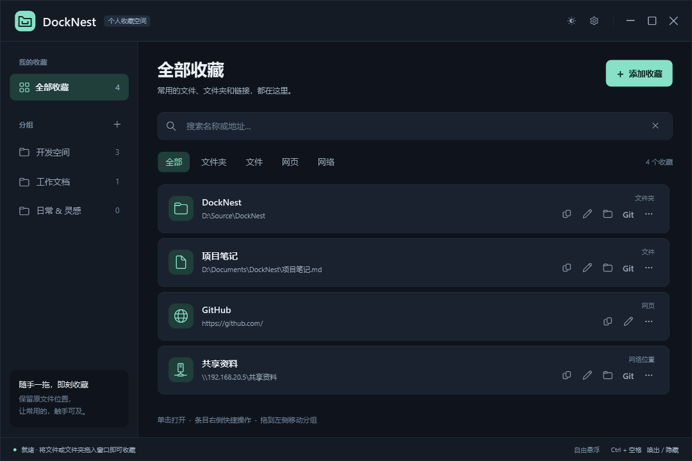
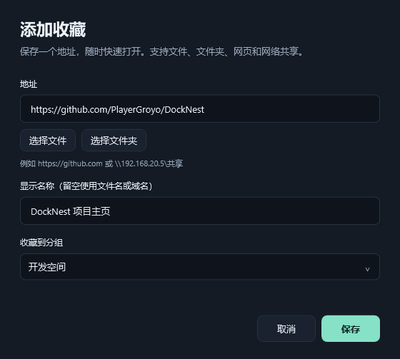
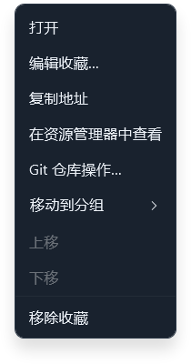
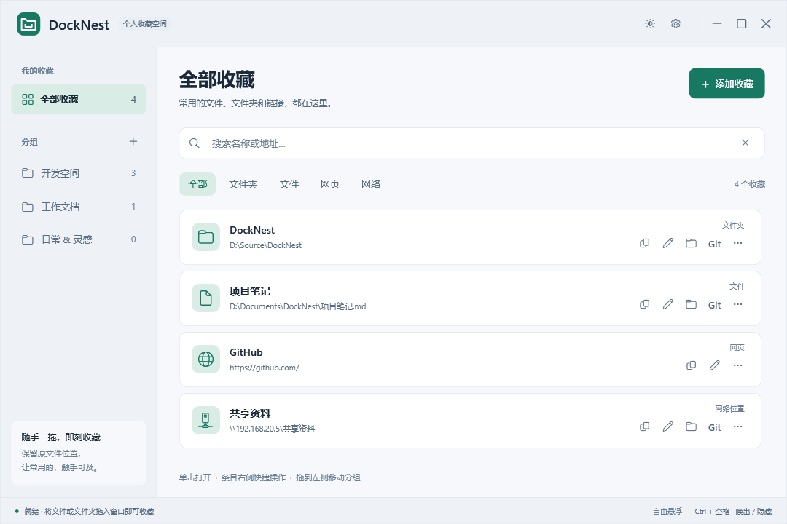
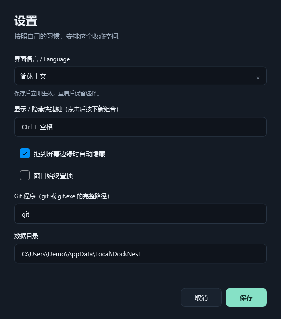
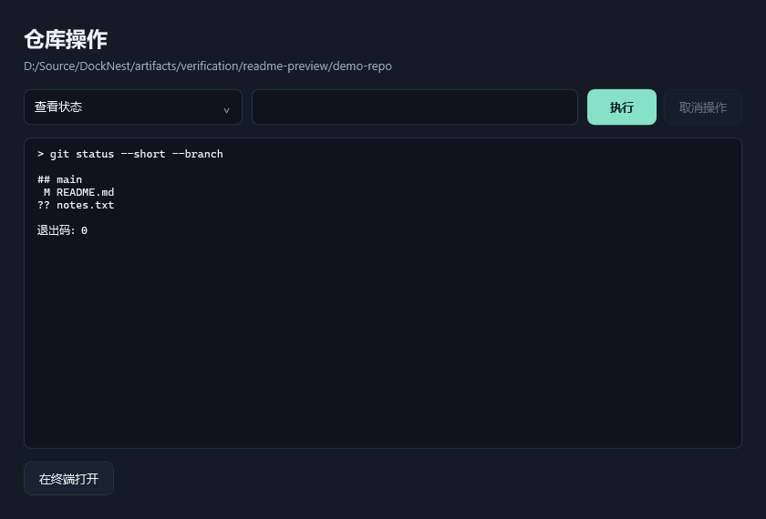

# DockNest

简体中文 | [English](README.en.md)

本机自用的 Windows 分组收藏工具。保留原文件位置，把常用文件、文件夹、网页和网络共享集中到一个窗口中。

## 使用

以下截图使用演示收藏和示例数据目录。首次启动为空，不预置示例收藏。

### 主界面与搜索

左侧切换分组或查看 **全部收藏**，右侧显示收藏列表。搜索会匹配名称和地址，范围为当前分组；选择“全部收藏”可搜索所有分组。搜索框下方可按文件夹、文件、网页、网络位置筛选。



### 创建分组与添加收藏

1. 点左侧“分组”旁的 **＋** 新建分组。
2. 点 **添加收藏** 输入地址，或选择本地文件 / 文件夹。
3. 按需填写显示名称、选择所属分组，点 **保存**。名称留空时使用文件名或域名。



也可以将资源管理器中的多个文件、文件夹拖进列表，或直接拖到左侧指定分组；支持拖入纯文本网址。同一分组会跳过重复地址，不同分组可以收藏同一个地址。

### 打开与管理收藏

**单击收藏打开**。条目右侧从左到右为 **复制地址、编辑、定位、Git、…**，悬停显示说明；网页条目提供复制、编辑和“…”菜单。点击按钮只执行对应操作，支持 Tab 聚焦后用 Enter / 空格执行。

| 操作 | 用途 |
| --- | --- |
| 复制地址 | 将文件路径、文件夹路径或网址复制到剪贴板 |
| 编辑 | 修改名称、地址或所属分组 |
| 定位 | 在资源管理器中查看对应文件或文件夹 |
| Git | 打开所属仓库的操作窗口，详见下方 [Git](#git) |
| … / 右键菜单 | 打开完整操作菜单，包括移动分组、上下排序和移除收藏 |



移除收藏只删除收藏记录，原文件保留在原处；删除分组只删除该组及收藏记录。

### 显示、托盘与贴边隐藏

- **Ctrl + 空格** 切换显示 / 隐藏。若被输入法等占用，会提示注册失败，可在设置中录入其他组合。
- 启动时显示系统托盘图标，单击或双击可唤出主窗口；右键可选择“显示主窗口”或“退出”。有未关闭的设置、编辑或 Git 弹窗时会先唤出该弹窗。Windows 可能将图标收进任务栏的隐藏图标区域（向上箭头）。
- 拖动标题栏靠近工作区四边（约 12 DIP）后进入自动隐藏；离开窗口后延时隐藏，留下 6 DIP 的绿色入口。鼠标移回入口可在其他窗口前方展开，不抢走当前输入焦点；移出后再次隐藏，拖离边缘退出停靠。退出停靠时恢复原来的置顶设置。设置、菜单、Git 窗口打开期间暂停隐藏。
- 最小化保留任务栏入口，关闭按钮退出程序。已启动时再次运行程序，会唤出已有窗口。

### 主题与设置

点右上角的主题按钮切换深浅主题，下面是浅色界面。



点右上角的齿轮按钮打开设置，可修改界面语言、显示 / 隐藏快捷键、贴边自动隐藏、窗口置顶和 Git 程序路径，也可查看数据目录。

**切换语言：设置 → 界面语言 / Language → 简体中文或 English → 保存。** 保存后立即更新主界面、托盘菜单和后续打开的弹窗，无需重启；下次启动会恢复选择。取消设置不会切换语言。首次启动及旧版本数据默认使用简体中文。

收藏名称、分组名称和路径保留原样。系统文件选择器、原生消息框按钮与系统错误信息由 Windows 提供，Git 命令输出保留 Git 原文。



### 键盘快捷键

| 快捷键 | 操作 |
| --- | --- |
| Ctrl + 空格 | 显示 / 隐藏窗口，可在设置中修改 |
| Ctrl + F | 聚焦搜索框 |
| Ctrl + N | 添加收藏 |
| Ctrl + Shift + N | 新建分组 |
| Enter / F2 / Delete | 在列表中打开 / 编辑 / 移除选中收藏 |

## Git

点击文件或文件夹条目右侧的 **Git**，打开所属仓库的操作窗口；选择操作后点 **执行**，结果会显示在下方。下图为“查看状态”的示例。



使用本机 `git.exe`，设置中可指定完整路径。通过 `rev-parse --show-toplevel` 识别普通仓库和 linked worktree；文件收藏会查找所属目录。网络路径的 Git 访问放在可取消的子进程中。

支持 status、未暂存 / 已暂存 diff、最近 30 条 log、fetch、pull --ff-only、git add --all、提交已暂存内容、push，以及在仓库目录打开 PowerShell。操作范围是**所属仓库**；“暂存仓库全部更改”会暂存仓库内所有更改。

修改仓库或访问远端的操作有确认窗口。命令通过 ArgumentList 传参，不拼接 shell 命令。显示退出码、标准输出和错误输出；支持取消及两分钟超时。显示结果最多保留每个输出流的一百万字符，以控制内存占用。

认证依赖本机 Git 配置。交互式凭据提示被禁用，认证失败时可在终端完成后重试。取消运行中的 Git 可能已产生部分更改，需重新查看状态。此版本未提供 reset、强制推送或自动解决冲突。

## 数据

默认保存到 `%LOCALAPPDATA%\DockNest\state.json`，包括分组、收藏、主题、语言、快捷键和窗口位置。使用临时文件及原子替换写入，保留上一版 `state.json.bak`。

JSON 损坏时尝试恢复备份，损坏文件另存为 `.corrupt-时间戳`；无法恢复则保留文件并提示错误。较新版本的数据会拒绝读取，避免降级覆盖。程序以单实例运行，避免多个窗口同时写入。

**备份时复制整个数据目录。更新程序只需退出后替换发布目录，不会覆盖用户数据。** 程序没有加入广告、遥测或在线更新服务。

## 开发与本机发布

沿用现有的 **.NET 8 WPF** 项目；构建需要 .NET 8 或兼容的新版本 SDK，运行需要 .NET 8 Desktop Runtime。

```powershell
dotnet build DockNest.csproj
dotnet run --project DockNest.csproj
dotnet publish DockNest.csproj -c Release -r win-x64 --self-contained false -p:DebugType=None -p:DebugSymbols=false -o artifacts/publish
```

本机运行 `artifacts/publish/DockNest.exe`，保留旁边的 DLL、配置文件等完整内容。Git 仍使用本机安装的版本，不打进发布包。

目录职责：`Models` 保存数据结构，`ViewModels` 管理分组与筛选，`Services` 处理持久化、路径、Git、主题、语言及窗口行为，`Interop` 封装 Win32，`Views` 为任务弹窗，`Themes` 为样式，`Localization` 为内嵌的中英文文字资源，`Assets` 为应用图标。窗口代码负责事件和对话框，业务服务可独立验证。

## 验证

```powershell
dotnet run --project Tests/DockNest.Checks.csproj -- artifacts/verification
```

仅验证停靠隐藏（包括真实计时器和四边入口的实际窗口尺寸）：

```powershell
dotnet run --project Tests/DockNest.Checks.csproj -- --docking artifacts/verification
```

仅验证托盘图标注册、隐藏 / 最小化 / 停靠后的恢复，以及退出保存和图标清理：

```powershell
dotnet run --project Tests/DockNest.Checks.csproj -- --tray artifacts/verification
```

仅验证中英文切换、设置保存 / 取消、旧数据兼容、托盘更新和重启恢复：

```powershell
dotnet run --project Tests/DockNest.Checks.csproj -- --localization artifacts/verification
```

验证输出集中在 `artifacts/verification`：`result.json` 为全部检查结果，`docking-result.json`、`tray-result.json`、`localization-result.json` 分别为停靠、托盘和语言专项结果，PNG 为真实 WPF 控件渲染，`fixtures/` 为每次运行独立的收藏数据、Git 仓库和本地裸远端。测试不会使用真实收藏目录，也不会向远程 Git 服务推送。

覆盖路径识别、离线 UNC、重复处理、分组搜索、原文件保留、持久化与损坏恢复、Git worktree / diff / 本地 fetch-pull-push / 取消、快捷键冲突、Win32 窗口停靠状态、系统托盘及深浅主题渲染。停靠测试使用真实窗口、计时器和窗口层级，加受控的鼠标坐标输入，验证反复隐藏展开、置顶窗口遮挡、焦点保留及退出停靠；托盘测试查询实际 Windows 图标注册，并向托盘消息窗口发送点击回调，验证显示、弹窗保护、取消退出、保存和释放。测试宿主只加载应用资源，不运行正式程序的单实例及用户数据启动逻辑。鼠标实际操作、多显示器混合 DPI、真实 SMB 认证、远程 Git 凭据仍需在使用环境中验证。

## 依赖和素材来源

- [WPF UI 4.3.0](https://github.com/lepoco/wpfui)：主题和控件基础，MIT；包含同版本 WPF-UI.Abstractions。
- [CommunityToolkit.Mvvm 8.4.2](https://github.com/CommunityToolkit/dotnet)：属性通知生成，MIT。
- 系统托盘使用 .NET Desktop Runtime 自带的 Windows Forms `NotifyIcon`，复用现有应用图标。
- 应用文字使用系统 Segoe UI / Microsoft YaHei UI，界面符号使用系统 Segoe Fluent Icons / Segoe MDL2 Assets。没有单独下载或安装新字体。WPF UI 自身内置的图标和字体资源及各自条款见 `THIRD-PARTY-NOTICES.txt`。
- `Assets/DockNest.svg` 和 `.ico` 是为本项目绘制的文件夹图标；ICO 含 16、32、48、128、256 像素版本。

项目代码采用 MIT 许可，第三方版权和许可随发布文件保留。
